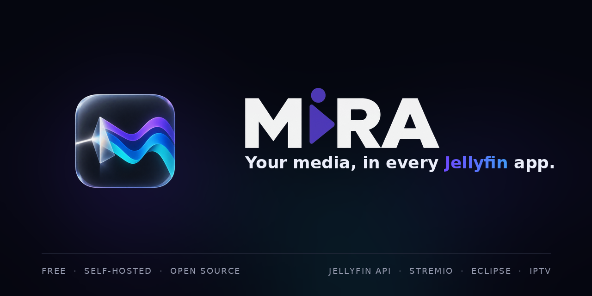

<p align="center"><a href="https://ferforastieri.github.io/mira/videos/mira-ad.mp4"></a></p>

# Mira

Mira is a self-hosted, **Jellyfin-compatible media server**. It turns Stremio addons, music addons, IPTV sources, local folders and network shares into libraries that any Jellyfin app can play, with real user accounts, transcoding and a web client, and without Jellyfin installed.

[**Documentation**](https://ferforastieri.github.io/mira/docs/) · [Releases](https://github.com/ferforastieri/mira/releases) · [Issues](https://github.com/ferforastieri/mira/issues) · [Discussions](https://github.com/ferforastieri/mira/discussions)

## What you get

- **Addons as libraries**: Stremio catalogs become libraries and collections, and their streams become versions of a title.
- **Live TV and IPTV**: M3U playlists, Xtream Codes accounts and HDHomeRun tuners, with a programme guide, recordings and Replay.
- **Your own files**: local folders, SMB, WebDAV, S3, SFTP and rclone remotes, with naming and matching.
- **Music, audiobooks and podcasts**: Eclipse music addons and local music become proper libraries.
- **Real accounts**: per-user watch state, resume points, favourites, parental control, limits, Quick Connect and imports from Jellyfin, Emby or Plex.
- **Transcoding**: direct play when the app can, else repackage or HLS conversion on NVIDIA, AMD, Intel or VideoToolbox, with HDR tone mapping.
- **Built in**: web player, admin app, DLNA, skip buttons, tracking, notifications, statistics, backups and Prometheus metrics.
- **Six languages**: English, French, German, Spanish, Italian and Brazilian Portuguese.

## Works with your apps

Infuse, Swiftfin, Findroid, Streamyfin, Strand, Odin, VidHub, Nuvio, Kodi and the official Jellyfin apps connect to Mira as they would to Jellyfin. See [Jellyfin apps](https://ferforastieri.github.io/mira/docs/jellyfin-compatibility).

## Quick start

Requirements: Docker with Compose v2. The image is published for `linux/amd64` and `linux/arm64`.

```sh
git clone https://github.com/ferforastieri/mira.git
cd mira
cp .env.example .env
# set POSTGRES_PASSWORD in .env: openssl rand -hex 24 makes one
docker compose up -d
```

1. Open `http://<server>:8096/admin/`.
2. Enter the one-time setup code from `docker compose logs mira` to create the administrator.
3. Continue with [Getting started](https://ferforastieri.github.io/mira/docs/getting-started).

Optional: set `MIRA_SECRET_KEY` in `.env` to encrypt the API keys and tokens stored in the database. Keep a copy with your backups.

## Documentation

The full documentation is at **<https://ferforastieri.github.io/mira/docs/>**, or in [`docs/`](docs/README.md) on GitHub. It covers installation, addons, IPTV, local files, users, transcoding, backups, themes and the API.

## Development

```sh
# Website and docs
npm --prefix docs ci
npm --prefix docs run dev     # http://127.0.0.1:5173/mira/
npm --prefix docs run check
npm --prefix docs run build

# Server
go test ./...
make build
```

See [`docs/development.md`](docs/development.md) for the full development setup and [`CONTRIBUTING.md`](CONTRIBUTING.md) for the workflow.

## Status

Mira is in **early development**. Expect changes between releases, and report problems in the [issues](https://github.com/ferforastieri/mira/issues).

## Legal

Mira does not host, store or distribute any content. It only relays what the addons and services configured by its operator provide. You are solely responsible for the addons and services you configure and for complying with the laws that apply to you.

Mira is an independent project, not affiliated with or endorsed by Jellyfin or Stremio.

## License

Released under the [MIT License](LICENSE).
